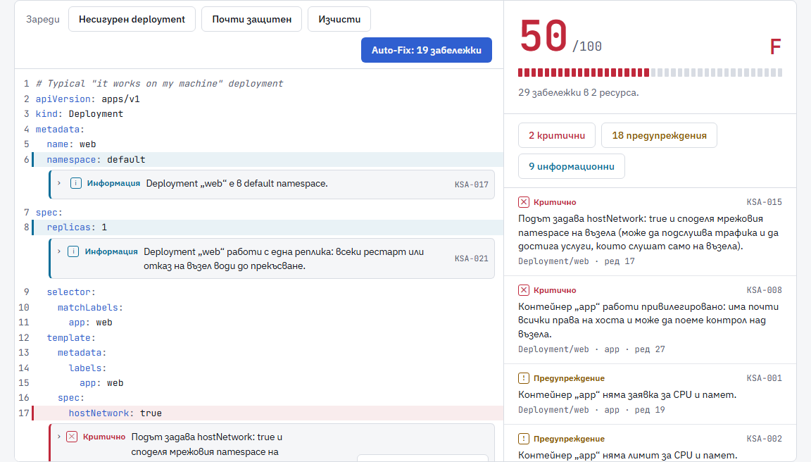
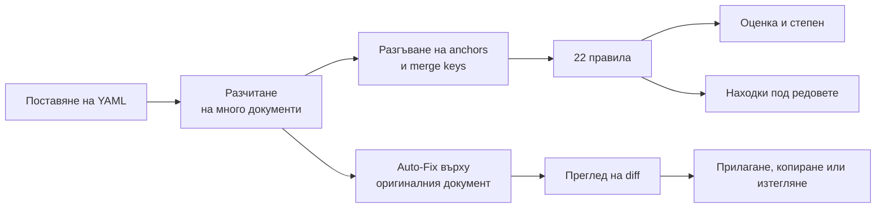
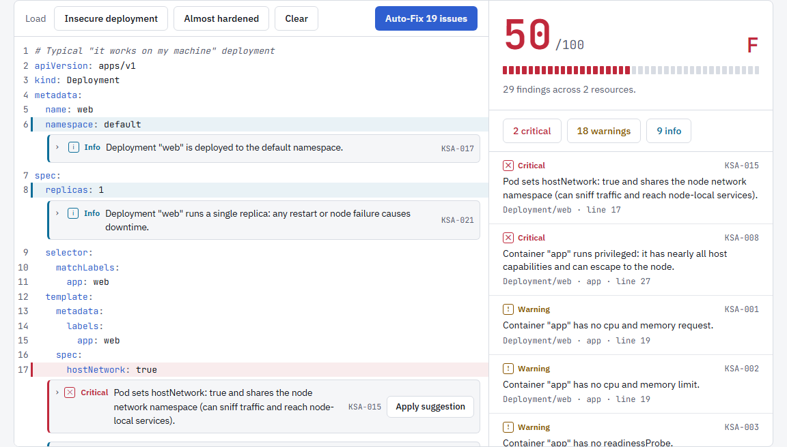
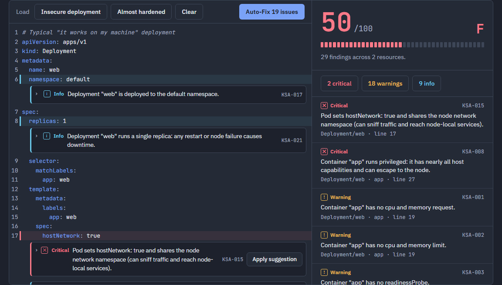
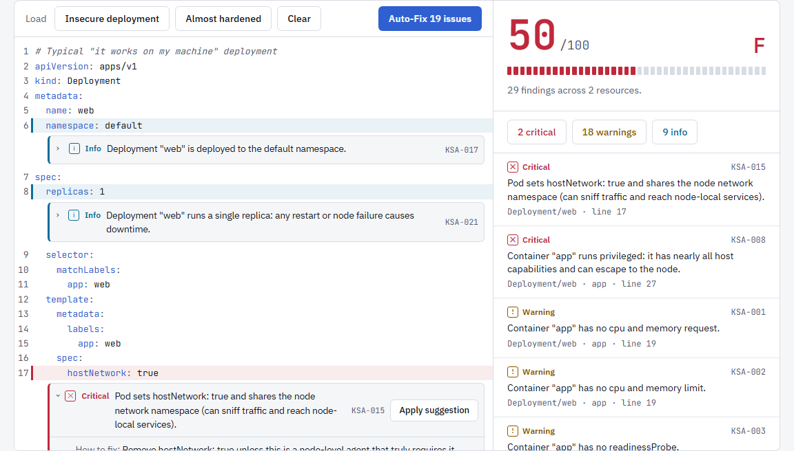
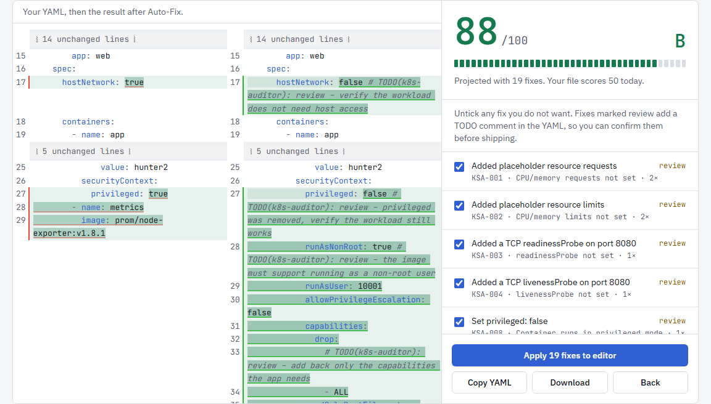
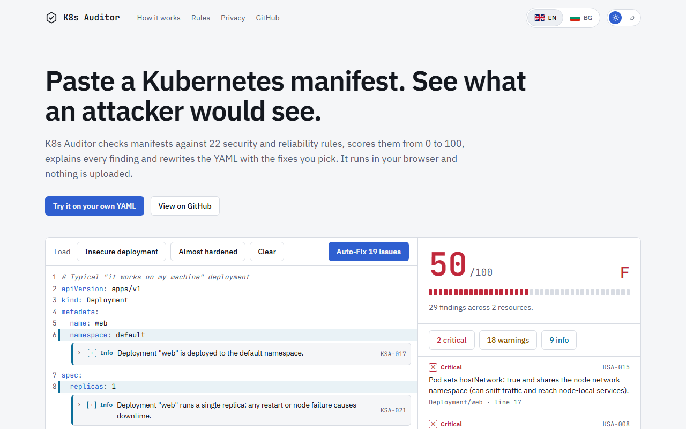

<div align="center">

# K8s Auditor

**Инструмент за проверка на Kubernetes манифести, който работи изцяло във вашия браузър.**
Поставяте манифест, получавате оценка за сигурността, разбирате всяка находка и я поправяте с едно щракване.

[](https://github.com/Gurmeta/K8s-Auditor/actions/workflows/ci.yml)
[](LICENSE)


**[Демо на живо](https://gurmeta.github.io/K8s-Auditor/)** · [English](README.md) · **Български**



</div>

## Съдържание

- [Защо съществува](#защо-съществува)
- [Възможности](#възможности)
- [Как работи](#как-работи)
- [Какво проверява](#какво-проверява)
- [Auto-Fix](#auto-fix)
- [Снимки](#снимки)
- [Поверителност и сигурност](#поверителност-и-сигурност)
- [Технологичен стек](#технологичен-стек)
- [Архитектура](#архитектура)
- [Начало](#начало)
- [Качество](#качество)
- [Как се добавя правило](#как-се-добавя-правило)
- [Публикуване](#публикуване)
- [Ограничения](#ограничения)
- [Планове](#планове)
- [Лиценз и източници](#лиценз-и-източници)

## Защо съществува

Повечето грешки в Kubernetes, които стигат до production, не са екзотични. Това е липсващ лимит на ресурсите, контейнер, който работи като root, образ със `:latest`. Скенерите на клъстера ги откриват късно, а инструментите за командния ред изискват инсталация и конфигурация, преди да видите каквото и да е.

K8s Auditor съкращава този цикъл. Отваряте страницата, поставяте YAML и виждате какво не е наред, защо има значение, с кой стандарт е свързано и как да се поправи. Нищо не се инсталира и нищо не се качва никъде.

## Възможности

- **22 правила** за ресурси, проби за здраве, образи, привилегии, достъп до хоста и хигиена. Където има приложим стандарт, правилото е свързано с Pod Security Standards, CIS Kubernetes Benchmark или ръководството за заздравяване на NSA/CISA.
- **Оценка от 0 до 100** със степен. Тежестта е претеглена, повторенията на едно правило струват все по-малко, а всяка критична находка ограничава оценката отгоре.
- **Находки под реда, към който се отнасят.** Отваряте една и виждате предложената промяна като diff, който можете да приложите самостоятелно.
- **Auto-Fix с преглед.** Всяка промяна се показва като diff една до друга, махате отметката на тези, които не искате, и после прилагате, копирате или изтегляте резултата.
- **Коментарите и редът на ключовете се запазват.** Поправките редактират разчетения YAML документ, а не текста.
- **Anchors, aliases и merge keys** (`&a`, `*a`, `<<`) се разгъват преди изпълнението на правилата, затова стойностите, които идват от alias, също се проверяват.
- **Български и английски**, светла и тъмна тема (светла по подразбиране), удобно с клавиатура.
- **Нула мрежови заявки по време на работа.** Без backend, без аналитика, без външни шрифтове и скриптове.

## Как работи



Анализът и поправката нарочно работят върху две отделни разчитания. Правилата четат разгънато копие, затова виждат стойностите през alias. Поправката редактира оригиналния документ, така че вашите anchors, коментари и подредба остават там, където сте ги сложили.

## Какво проверява

Тежестта определя оценката: критична отнема 15 точки, предупреждение 5, информация 1. Повторенията на едно и също правило отнемат все по-малко, а всяка критична находка ограничава оценката до 60.

| Област | ID | Правило | Тежест | Auto-Fix |
| --- | --- | --- | --- | --- |
| Ресурси | KSA-001 | Липсват CPU и памет като заявка (requests) | предупреждение | примерни стойности, маркирани за преглед |
| | KSA-002 | Липсват CPU и памет като лимит (limits) | предупреждение | примерни стойности, маркирани за преглед |
| Здраве | KSA-003 | Липсва `readinessProbe` | предупреждение | TCP проба, само ако има `containerPort` |
| | KSA-004 | Липсва `livenessProbe` | предупреждение | TCP проба, само ако има `containerPort` |
| Образи | KSA-005 | Образ със `:latest` или без таг | предупреждение | никога, изисква човешко решение |
| | KSA-006 | Образ, който не е фиксиран с digest | информация | никога |
| | KSA-007 | `imagePullPolicy` не изтегля отново променлив образ | информация | никога |
| Привилегии | KSA-008 | Контейнер в privileged режим | критична | да, маркирана за преглед |
| | KSA-009 | Контейнерът може да работи като root | предупреждение | да, маркирана за преглед |
| | KSA-010 | Не е забранено повишаването на привилегиите | предупреждение | да |
| | KSA-011 | Linux capabilities не са премахнати | предупреждение | да, маркирана за преглед |
| | KSA-012 | Коренната файлова система е за запис | информация | да, маркирана за преглед |
| | KSA-013 | Няма наложен seccomp профил | предупреждение | да |
| | KSA-014 | Няма зададен `securityContext` | информация | покрива се от правилата по-горе |
| Достъп до хоста | KSA-015 | Pod споделя namespaces на хоста | критична | да, маркирана за преглед |
| | KSA-016 | Монтиран `hostPath` том | предупреждение | никога |
| Хигиена | KSA-017 | Ресурсът изрично ползва namespace `default` | информация | никога |
| | KSA-018 | Ползва ServiceAccount по подразбиране | информация | никога |
| | KSA-019 | Токенът на ServiceAccount се монтира автоматично | информация | да, маркирана за преглед |
| | KSA-020 | Чувствителна стойност в `env` като обикновен текст | предупреждение | никога |
| | KSA-021 | Конфигурирана е само една реплика | информация | никога |
| | KSA-022 | Service е изложен извън клъстера | информация | никога |

## Auto-Fix

- Поправката е **безопасна** (safe) или **за преглед** (review). Поправките за преглед добавят коментар `# TODO(k8s-auditor): review` до промяната, за да я потвърди човек, преди да тръгне в production.
- Никога не гадае стойности, които не може да знае. Образ със `:latest` остава `:latest`, а стойностите за ресурси са обозначени като примерни.
- Лимитът никога не се задава под съществуваща заявка, а заявката никога не се задава над съществуващ лимит.
- Поправките, които прилагате една по една, и тези, които преглеждате заедно, ползват един и същ механизъм.
- Сериализаторът нормализира отстъпите, затова diff може да съдържа промени в празното пространство извън самите поправки.

## Снимки

<table>
  <tr>
    <td width="50%"><br><sub>Светла тема: редакторът с находки под редовете, оценката и списъкът с резултати.</sub></td>
    <td width="50%"><br><sub>Тъмна тема със същото разположение и контраст.</sub></td>
  </tr>
  <tr>
    <td width="50%"><br><sub>Находка, отворена под своя ред, с поправка, която се прилага самостоятелно.</sub></td>
    <td width="50%"><br><sub>Преглед на Auto-Fix: diff, прогнозна оценка и превключвател за всяка поправка.</sub></td>
  </tr>
</table>

Интерфейсът има и английска версия:



## Поверителност и сигурност

- **Нищо не напуска вашата машина.** Няма backend и аналитика. Production билдът включва Content Security Policy с `default-src 'self'` и `connect-src 'none'`, така че страницата не може да изпрати вашия YAML никъде, дори по погрешка.
- **Без външни ресурси по време на работа.** Шрифтовете (IBM Plex Sans, JetBrains Mono) са вградени чрез npm.
- **Защитно разчитане.** Вход над 300 KB се отказва със съобщение, а aliases, които се разгъват над определен бюджет от възли, се отхвърлят, така че нарочно създаден файл тип "billion laughs" не може да изчерпи паметта.
- **Верига на доставки.** Зависимостите са с фиксирани версии, а lockfile е в репото. CI използва `npm ci` и `npm audit`, GitHub Actions са фиксирани по commit хеш с права само за четене, а Dependabot поддържа и двете актуални.

## Технологичен стек

| Слой | Избор | Защо |
| --- | --- | --- |
| Език | TypeScript 6, strict режим | Договорите на правилата и поправките са типизирани от край до край |
| UI | React 19 | Малко дърво от компоненти, не е нужна библиотека за състояние |
| Билд | Vite 8 | Бърз dev сървър, статичен изход за GitHub Pages |
| Стилове | Tailwind CSS 4 с токени като CSS променливи | Един набор токени управлява светлата и тъмната тема |
| Редактор | CodeMirror 6, `@codemirror/merge` | Вградени елементи под редовете, diff една до друга |
| YAML | [`yaml`](https://github.com/eemeli/yaml) 2.x | Пази коментарите, реда на ключовете и позициите в изходния текст. `js-yaml` губи коментарите |
| Тестове | Vitest 5 | Бърз, тества чистото ядро без DOM |
| Lint | oxlint | Бърз, с правила за React hooks и TypeScript |
| Хостинг | GitHub Pages чрез GitHub Actions | Статичен, без сървър за поддръжка |

## Архитектура

```text
src/core/        чиста логика, без React и без DOM
  parser/        многодокументен YAML с грешки по ред и колона, разгъване на aliases
  podSpec/       намиране на pod spec и контейнери за всеки вид натоварване
  rules/         по един файл на правило, регистрирани в rules/index.ts
  scoring/       претеглена оценка и степен
  fixer/         поправки, запазващи коментарите, върху YAML документа
  limits.ts      ограничение на размера на входа
src/i18n/        текстове на английски и български, плюс български формулировки за всяко правило и поправка
src/ui/          React компоненти и разширенията на CodeMirror
tests/           Vitest, поне един тест на правило и тестове за fixer-а
docs/            снимки, използвани в този README
```

Ядрото не зависи от React или DOM, затова същият механизъм може по-късно да задвижва инструмент за командния ред. Правилата връщат езиково неутрални находки с параметри, а интерфейсът ги превръща в текст на английски или български.

## Начало

Изисква Node 20.19 или по-нов.

```sh
git clone https://github.com/Gurmeta/K8s-Auditor.git
cd K8s-Auditor
npm ci
npm run dev        # http://localhost:5173/K8s-Auditor/
```

| Команда | Какво прави |
| --- | --- |
| `npm run dev` | Сървър за разработка |
| `npm test` | Unit тестове |
| `npm run lint` | oxlint |
| `npm run build` | Проверка на типовете и production билд |
| `npm run preview` | Показва production билда на `http://localhost:4173/K8s-Auditor/` |

## Качество

- Strict TypeScript, проверка с oxlint, над 130 unit теста с поне един на правило и отделни тестове за fixer-а, разгъването на aliases, ограничението на размера и преводите.
- CI изпълнява инсталация, `npm audit`, lint, тестове и production билд при всеки push и pull request.
- Тест пропада, ако правило няма българска формулировка или ако двата езикови файла се разминат.

## Как се добавя правило

1. Създайте `src/core/rules/<name>.ts`, който експортира `Rule` с `id`, `severity`, видовете, към които се прилага (`appliesTo`), и `check`, който връща находки (`makeFinding` или `makeResourceFinding` попълват пътя и реда). Подайте динамичните стойности (контейнер, образ, порт) като последен аргумент `params`, за да може съобщението да се формулира на други езици.
2. Регистрирайте го в `src/core/rules/index.ts` и го добавете към група в `src/ui/ruleGroups.ts`.
3. Добавете българската му формулировка в `src/i18n/rules-bg.ts`. Тестът за i18n пропада, докато всяко правило няма такава.
4. Добавете тестове в `tests/`.
5. По желание добавете поправка в `src/core/fixer/fixes.ts` с ключ id-то на правилото (и неговото българско описание в `rules-bg.ts`). Върнете `null`, когато поправката изисква човек.

## Публикуване

Сайтът е статичен билд, обслужван от GitHub Pages. `.github/workflows/deploy.yml` изпълнява lint, тестове и билд, после публикува `dist/`. Стартира се само ръчно от раздела Actions, а всяко action е фиксирано по commit хеш. Приложението се сервира под `/K8s-Auditor/`, зададено като `base` във `vite.config.ts`.

## Ограничения

Това е статична проверка на манифеста, който поставяте. Не вижда клъстера, admission контролерите, NetworkPolicies, RBAC или нещо, дефинирано в друг файл.

- YAML anchors, aliases и merge keys се разгъват преди изпълнението на правилата, а находка, която идва от alias, сочи реда на anchor-а. Auto-Fix работи върху оригиналния текст и оставя вашите anchors на място, затова пропуска места, които съществуват само през alias.
- Вход над 300 KB не се проверява, а файл, чиито aliases се разгъват до неразумен размер, се отхвърля.

За CI върху истинско репо ползвайте [kube-linter](https://github.com/stackrox/kube-linter), [Kubescape](https://github.com/kubescape/kubescape) или [Polaris](https://github.com/FairwindsOps/polaris). Техните списъци с проверки бяха ориентир при избора кои правила да се включат.

## Планове

- Експорт на находките като JSON, SARIF и Markdown.
- Споделяне на манифест през URL hash, без сървър.
- Коментар за пропускане, например `# k8s-auditor:ignore KSA-012`.
- Още правила: NetworkPolicy, PodDisruptionBudget, `hostPort`, опасни `capabilities.add`, RBAC със заместващи символи.
- Инструмент за командния ред върху същото ядро.
- Web Worker за големи манифести и автоматизиран smoke тест в браузър.

## Лиценз и източници

Публикуван под [MIT License](LICENSE).

Изборът на правила се опира на Kubernetes Pod Security Standards, CIS Kubernetes Benchmark, NSA/CISA Kubernetes Hardening Guide и списъците с проверки на kube-linter, Polaris и Kubescape.

Автор: [Georgi Stefanov](https://github.com/Gurmeta).
