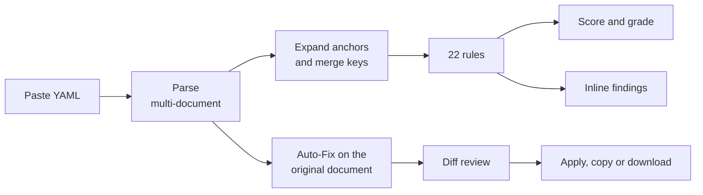

<div align="center">

# K8s Auditor

**A Kubernetes manifest linter that runs entirely in your browser.**
Paste a manifest, get a security score, understand every finding and fix it with one click.

[](https://github.com/Gurmeta/K8s-Auditor/actions/workflows/ci.yml)
[](LICENSE)


**[Live demo](https://gurmeta.github.io/K8s-Auditor/)** · **English** · [Български](README.bg.md)


</div>

## Contents

- [Why it exists](#why-it-exists)
- [Features](#features)
- [How it works](#how-it-works)
- [What it checks](#what-it-checks)
- [Auto-Fix](#auto-fix)
- [Screenshots](#screenshots)
- [Privacy and security](#privacy-and-security)
- [Tech stack](#tech-stack)
- [Architecture](#architecture)
- [Getting started](#getting-started)
- [Quality](#quality)
- [Adding a rule](#adding-a-rule)
- [Deployment](#deployment)
- [Limits](#limits)
- [Roadmap](#roadmap)
- [License and credits](#license-and-credits)

## Why it exists

Most Kubernetes mistakes that reach production are not exotic. They are a missing resource limit, a container running as root, an image pinned to `:latest`. Cluster scanners catch them late, and command line linters need an install and a config before you see anything.

K8s Auditor shortens that loop. Open the page, paste YAML, and see what is wrong, why it matters, which standard it maps to and how to fix it. Nothing is installed and nothing is uploaded.

## Features

- **22 rules** across resources, health probes, images, privileges, host access and hygiene, each mapped to the Pod Security Standards, the CIS Kubernetes Benchmark or the NSA/CISA hardening guide where one applies.
- **A 0 to 100 score** with a grade. Severity is weighted, repeats of the same rule cost less each time, and any critical finding caps the score.
- **Findings under the line they belong to.** Open one to see the suggested change as a diff and apply it on its own.
- **Auto-Fix with a review step.** See every change as a diff, untick the ones you do not want, then apply, copy or download the result.
- **Comments and key order survive.** Fixes edit the parsed YAML document, not the text.
- **Anchors, aliases and merge keys** (`&a`, `*a`, `<<`) are expanded before the rules run, so values that come from an alias are checked.
- **English and Bulgarian**, light and dark theme (light by default), keyboard friendly.
- **Zero runtime network access.** No backend, no analytics, no external fonts or scripts.

## How it works



The analysis and the fixer deliberately work on two separate parses. Rules read an expanded copy, so aliased values are seen. The fixer edits the original document, so your anchors, comments and ordering stay where you put them.

## What it checks

Severity drives the score: critical costs 15 points, warning 5, info 1. Repeats of the same rule cost less each time, and any critical finding caps the score at 60.

| Area | ID | Rule | Severity | Auto-Fix |
| --- | --- | --- | --- | --- |
| Resources | KSA-001 | CPU and memory requests not set | warning | placeholders, marked for review |
| | KSA-002 | CPU and memory limits not set | warning | placeholders, marked for review |
| Health | KSA-003 | `readinessProbe` not set | warning | TCP probe, only if a `containerPort` exists |
| | KSA-004 | `livenessProbe` not set | warning | TCP probe, only if a `containerPort` exists |
| Images | KSA-005 | Image uses `:latest` or has no tag | warning | never, needs a human decision |
| | KSA-006 | Image not pinned by digest | info | never |
| | KSA-007 | `imagePullPolicy` does not re-pull a mutable image | info | never |
| Privileges | KSA-008 | Container runs in privileged mode | critical | yes, marked for review |
| | KSA-009 | Container may run as root | warning | yes, marked for review |
| | KSA-010 | Privilege escalation not disabled | warning | yes |
| | KSA-011 | Linux capabilities not dropped | warning | yes, marked for review |
| | KSA-012 | Root filesystem is writable | info | yes, marked for review |
| | KSA-013 | No seccomp profile enforced | warning | yes |
| | KSA-014 | No `securityContext` defined | info | covered by the rules above |
| Host access | KSA-015 | Pod shares host namespaces | critical | yes, marked for review |
| | KSA-016 | `hostPath` volume mounted | warning | never |
| Hygiene | KSA-017 | Resource explicitly uses the `default` namespace | info | never |
| | KSA-018 | Uses the default ServiceAccount | info | never |
| | KSA-019 | ServiceAccount token auto-mounted | info | yes, marked for review |
| | KSA-020 | Sensitive value in a plaintext `env` var | warning | never |
| | KSA-021 | Only one replica configured | info | never |
| | KSA-022 | Service exposed outside the cluster | info | never |

## Auto-Fix

- A fix is either **safe** or **review**. Review fixes add a `# TODO(k8s-auditor): review` comment next to the change, so a human confirms it before it ships.
- It never guesses values it cannot know. A `:latest` image stays `:latest`, and resource values are labelled placeholders.
- A limit is never set below an existing request, and a request is never set above an existing limit.
- Fixes you apply one at a time and fixes you review together use the same engine.
- The serializer normalizes indentation, so a diff can include whitespace changes beyond the fixes themselves.

## Screenshots

<table>
  <tr>
    <td width="50%"><br><sub>Light theme: the editor with inline findings, score and results list.</sub></td>
    <td width="50%"><br><sub>Dark theme, with the same layout and contrast.</sub></td>
  </tr>
  <tr>
    <td width="50%"><br><sub>A finding opened under its line, with the fix to apply on its own.</sub></td>
    <td width="50%"><br><sub>Auto-Fix review: a diff, a projected score and a switch per fix.</sub></td>
  </tr>
</table>

The interface also comes in Bulgarian:


## Privacy and security

- **Nothing leaves your machine.** There is no backend and no analytics. The production build ships a Content Security Policy with `default-src 'self'` and `connect-src 'none'`, so the page cannot send your YAML anywhere even by mistake.
- **No third party assets at runtime.** Fonts (IBM Plex Sans, JetBrains Mono) are bundled through npm.
- **Defensive parsing.** Input over 300 KB is refused with a message, and aliases that expand past a node budget are rejected, so a crafted "billion laughs" file cannot exhaust memory.
- **Supply chain.** Dependencies are pinned and the lockfile is committed. CI uses `npm ci` and `npm audit`, GitHub Actions are pinned to commit hashes with read only permissions, and Dependabot keeps both up to date.

## Tech stack

| Layer | Choice | Why |
| --- | --- | --- |
| Language | TypeScript 6, strict mode | The rule and fixer contracts are typed end to end |
| UI | React 19 | Small component tree, no state library needed |
| Build | Vite 8 | Fast dev server, static output for GitHub Pages |
| Styling | Tailwind CSS 4 with CSS variable tokens | One token set drives the light and dark themes |
| Editor | CodeMirror 6, `@codemirror/merge` | Inline widgets under lines, unified diffs |
| YAML | [`yaml`](https://github.com/eemeli/yaml) 2.x | Keeps comments, key order and source positions. `js-yaml` drops comments |
| Tests | Vitest 5 | Fast, runs against the pure core without a DOM |
| Lint | oxlint | Fast, with React hooks and TypeScript rules |
| Hosting | GitHub Pages via GitHub Actions | Static, no server to run |

## Architecture

```text
src/core/        pure logic, no React and no DOM
  parser/        multi-document YAML with line and column errors, alias expansion
  podSpec/       pod spec and container lookup per workload kind
  rules/         one file per rule, registered in rules/index.ts
  scoring/       weighted score and grade
  fixer/         comment-preserving patches on the YAML document
  limits.ts      input size limit
src/i18n/        English and Bulgarian texts, plus Bulgarian wording for each rule and fix
src/ui/          React components and the CodeMirror extensions
tests/           Vitest, at least one test per rule and for the fixer
docs/            screenshots used in this README
```

The core has no dependency on React or the DOM, so the same engine can power a command line tool later. Rules return language neutral findings with parameters, and the interface turns them into English or Bulgarian text.

## Getting started

Requires Node 20.19 or newer.

```sh
git clone https://github.com/Gurmeta/K8s-Auditor.git
cd K8s-Auditor
npm ci
npm run dev        # http://localhost:5173/K8s-Auditor/
```

| Command | What it does |
| --- | --- |
| `npm run dev` | Development server |
| `npm test` | Unit tests |
| `npm run lint` | oxlint |
| `npm run build` | Type check and production build |
| `npm run preview` | Serve the production build at `http://localhost:4173/K8s-Auditor/` |

## Quality

- Strict TypeScript, linted with oxlint, 130+ unit tests with at least one per rule and dedicated tests for the fixer, the alias expansion, the size limit and the translations.
- CI runs install, `npm audit`, lint, tests and the production build on every push and pull request.
- A test fails if a rule has no Bulgarian wording or if the two language files drift apart.

## Adding a rule

1. Create `src/core/rules/<name>.ts` exporting a `Rule` with an `id`, `severity`, the kinds it `appliesTo`, and a `check` that returns findings (`makeFinding` or `makeResourceFinding` fill in the path and line). Pass the dynamic values (container, image, port) as the last `params` argument so the message can be phrased in other languages.
2. Register it in `src/core/rules/index.ts` and add it to a group in `src/ui/ruleGroups.ts`.
3. Add its Bulgarian wording in `src/i18n/rules-bg.ts`. The i18n test fails until every rule has one.
4. Add tests in `tests/`.
5. Optionally add a fix in `src/core/fixer/fixes.ts`, keyed by the rule id (and its Bulgarian description in `rules-bg.ts`). Return `null` when the fix needs a human.

## Deployment

The site is a static build served from GitHub Pages. `.github/workflows/deploy.yml` runs lint, tests and the build, then publishes `dist/`. It only runs when started manually from the Actions tab, and every action is pinned to a commit hash. The app is served under `/K8s-Auditor/`, set as `base` in `vite.config.ts`.

## Limits

This is a static check of the manifest you paste. It does not see the cluster, admission controllers, NetworkPolicies, RBAC or anything defined in another file.

- YAML anchors, aliases and merge keys are expanded before the rules run, and a finding that comes from an alias points at the anchor line. Auto-Fix works on the original text and leaves your anchors in place, so it skips spots that only exist through an alias.
- Input over 300 KB is not checked, and a file whose aliases expand to an unreasonable size is rejected.

For CI use on a real repository, reach for [kube-linter](https://github.com/stackrox/kube-linter), [Kubescape](https://github.com/kubescape/kubescape) or [Polaris](https://github.com/FairwindsOps/polaris). Their check lists were a reference when choosing which rules to include.

## Roadmap

- Export findings as JSON, SARIF and Markdown.
- Share a manifest through the URL hash, without a server.
- An ignore comment, such as `# k8s-auditor:ignore KSA-012`.
- More rules: NetworkPolicy, PodDisruptionBudget, `hostPort`, dangerous `capabilities.add`, RBAC with wildcards.
- A command line tool built on the same core.
- A Web Worker for large manifests, and an automated browser smoke test.

## License and credits

Released under the [MIT License](LICENSE).

Rule selection draws on the Kubernetes Pod Security Standards, the CIS Kubernetes Benchmark, the NSA/CISA Kubernetes Hardening Guide and the check lists of kube-linter, Polaris and Kubescape.

Built by [Georgi Stefanov](https://github.com/Gurmeta).
